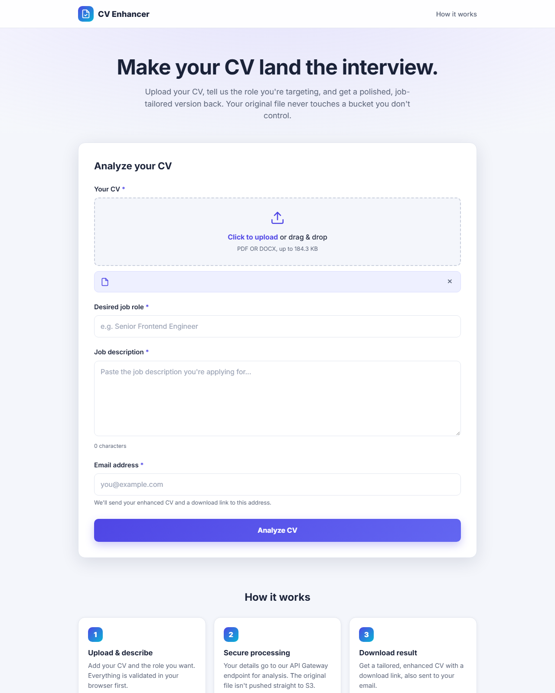
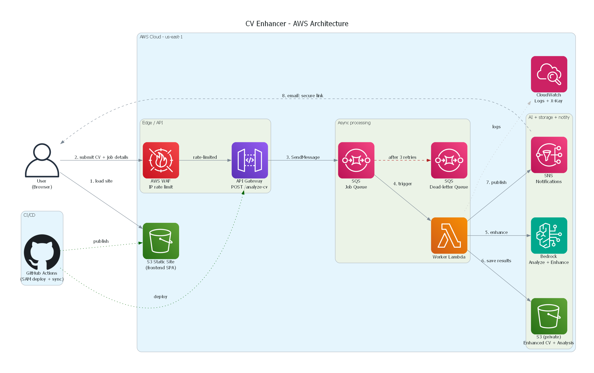

# CV Enhancer

[](https://github.com/Govinder-1992/CV-ENHANCER/actions/workflows/deploy.yml)
[](LICENSE)

An AI-powered CV enhancer built on AWS. A user uploads a CV (PDF or DOCX) with a
target job role, job description, and email. The system analyzes the CV against
the job, rewrites/enhances it with **Amazon Bedrock**, stores the result in
Amazon S3, and emails a secure download link — **without ever storing the
original CV**.

- **Frontend** — a static, responsive single-page site (HTML/CSS/JS) hosted on S3.
- **Backend** — AWS WAF → API Gateway → SQS → worker Lambda → Bedrock → S3 → SNS,
  defined as infrastructure-as-code with AWS SAM.
- **Security** — AWS WAF with an IP rate-limit rule guards the API; the original
  CV is never stored; data is encrypted at rest.
- **CI/CD** — GitHub Actions deploys the backend and publishes the frontend on
  every push to `main`.

---

## Demo



The single-page app: upload a PDF/DOCX CV, enter the target role, job
description, and email, then submit. Validation runs in the browser before the
request is queued for processing.

---

## Architecture



> Rendered with the official AWS Architecture icons via the
> [`diagrams`](https://diagrams.mingrammer.com/) library. To regenerate it, see
> [Regenerate the diagram](#regenerate-the-architecture-diagram).

### Request flow

1. **User → AWS WAF → Amazon API Gateway** — the browser sends `POST /analyze-cv`
   with the CV (base64) and job details. AWS WAF applies the IP rate-limit rule,
   then API Gateway validates the request body.
2. **API Gateway → Amazon SQS** — a direct AWS service integration puts the job
   on the queue (`SendMessage`). The API immediately returns `202 { requestId }`.
3. **SQS → Worker Lambda** — the queue triggers the worker (one message at a time).
4. **Lambda → Amazon Bedrock** — the worker extracts the CV text in memory and
   calls Bedrock to analyze and enhance it.
5. **Lambda → Amazon S3** — only the enhanced CV + analysis JSON are saved
   (the original CV is never written).
6. **Lambda → Amazon SNS** — a completion (or failure) notification is published.
7. **SNS → User** — the user receives an email with a secure, time-limited link.

Failed messages redrive to a **dead-letter queue** after 3 attempts.

---

## Repository layout

```
.
├── index.html / styles.css / app.js   # Frontend static site
├── config.js                          # Frontend runtime config (API endpoint)
├── template.yaml                      # SAM template (API, SQS, Lambda, S3, SNS, IAM)
├── samconfig.toml                     # Saved SAM deploy parameters
├── src/                               # Lambda source
│   ├── requirements.txt               # pypdf, python-docx
│   ├── app/
│   │   ├── worker.py                  # SQS-triggered entrypoint
│   │   ├── bedrock_client.py          # Bedrock analyze + enhance
│   │   ├── storage.py                 # S3 save + presigned URL
│   │   └── notifications.py           # SNS publish (per-user email)
│   └── common/
│       ├── validation.py              # file + field validation
│       ├── text_extraction.py         # PDF/DOCX -> text
│       ├── errors.py                  # typed errors
│       ├── logging_utils.py           # structured JSON logging
│       └── http.py                    # API Gateway responses + CORS
├── diagram/
│   ├── architecture.py                # Diagram-as-code (official AWS icons)
│   └── cv-enhancer-architecture.png   # Rendered diagram
└── .github/workflows/deploy.yml       # CI/CD pipeline
```

---

## Step-by-step setup

### Step 1 — Prerequisites

Install and configure:

- [AWS SAM CLI](https://docs.aws.amazon.com/serverless-application-model/latest/developerguide/install-sam-cli.html)
- [AWS CLI](https://docs.aws.amazon.com/cli/latest/userguide/getting-started-install.html), then `aws configure`
- Python 3.12
- (For the diagram) [Graphviz](https://graphviz.org/download/) and `pip install diagrams`

### Step 2 — Enable Amazon Bedrock model access

In the AWS Console → **Amazon Bedrock → Model access** (in your region), enable
the model used by `BedrockModelId`
(default `us.anthropic.claude-haiku-4-5-20251001-v1:0`). If prompted, complete
the Anthropic use-case form. Without this, processing fails with an access or
`ResourceNotFoundException` error.

### Step 3 — Build

```powershell
sam build
```

This installs `src/requirements.txt` (pypdf, python-docx) and packages the
worker Lambda.

### Step 4 — Deploy

```powershell
sam deploy
```

Parameters (saved in `samconfig.toml`; use `sam deploy --guided` to change them):

| Parameter               | Default                                      | Notes                                   |
| ----------------------- | -------------------------------------------- | --------------------------------------- |
| `StageName`             | `prod`                                       | API stage                               |
| `BedrockModelId`        | `us.anthropic.claude-haiku-4-5-20251001-v1:0`| Inference-profile id; must be enabled   |
| `MaxFileSizeMb`         | `5`                                          | Worker-side size cap                    |
| `CorsAllowOrigin`       | `*`                                          | Set to your site origin in production   |
| `NotificationEmail`     | *(empty)*                                    | Optional admin subscriber               |
| `DownloadUrlTtlSeconds` | `86400`                                      | Presigned URL lifetime                  |
| `AuthMode`              | `NONE`                                       | `NONE` (public) or `API_KEY`            |
| `EnableWaf`             | `true`                                       | Set `false` to skip WAF (saves cost)    |
| `WafRateLimit`          | `500`                                        | Max requests per IP per 5-min (WAF)     |

### Step 5 — Read the stack outputs

```powershell
aws cloudformation describe-stacks --stack-name sam-app --region us-east-1 --query "Stacks[0].Outputs" --output table
```

- `ApiEndpoint` → set as `API_ENDPOINT` in `config.js`.
- `FrontendWebsiteUrl` → the public site URL.
- `ResultsBucketName` → where enhanced CVs/analysis are stored.

### Step 6 — Publish the frontend

The CI pipeline does this automatically, or manually:

```powershell
# replace <FrontendBucketName> with the stack output
aws s3 sync . "s3://<FrontendBucketName>" --exclude "*" `
  --include "index.html" --include "app.js" --include "styles.css" --include "config.js"
```

### Step 7 — Test

Open `FrontendWebsiteUrl`, or run locally:

```powershell
python -m http.server 8080   # then open http://localhost:8080
```

Watch the worker process a submission:

```powershell
sam logs --stack-name sam-app --name WorkerFunction --region us-east-1 --tail
```

Confirm results were written to S3:

```powershell
aws s3 ls s3://<ResultsBucketName>/results/ --recursive --region us-east-1
```

---

## CI/CD with GitHub Actions

`.github/workflows/deploy.yml` runs on every push to `main` (and manual
dispatch) with two jobs:

1. **deploy** — `sam validate` → `sam build` → `sam deploy`.
2. **frontend** — reads `ApiEndpoint` from the stack outputs, injects it into
   `config.js`, and syncs the static site to the frontend S3 bucket.

### Set up the pipeline

1. Push the repo to GitHub:

   ```powershell
   git init -b main
   git add .
   git commit -m "Initial commit"
   gh repo create cv-enhancer --private --source=. --remote=origin --push
   ```

2. Add the AWS credentials as repository secrets:

   ```powershell
   gh secret set AWS_ACCESS_KEY_ID
   gh secret set AWS_SECRET_ACCESS_KEY
   ```

   Optional repository **variables** (defaults: `us-east-1`, `sam-app`):

   ```powershell
   gh variable set AWS_REGION --body "us-east-1"
   gh variable set STACK_NAME --body "sam-app"
   ```

3. Trigger a run:

   ```powershell
   gh workflow run "Deploy CV Enhancer (SAM)"
   gh run watch
   ```

The deploy IAM user needs permissions for CloudFormation, Lambda, API Gateway,
S3, SQS, SNS, IAM, and CloudWatch Logs.

---

## API reference

**Request** — `POST /analyze-cv` (JSON):

```json
{
  "fileName": "cv.pdf",
  "fileType": "pdf",
  "fileContentBase64": "JVBERi0xLjQ...",
  "jobRole": "Senior Frontend Engineer",
  "jobDescription": "We are looking for...",
  "email": "you@example.com"
}
```

**Accepted** — `202`:

```json
{ "requestId": "a1b2c3d4-...", "status": "processing", "message": "..." }
```

Results are emailed and stored in S3 at `results/<requestId>/enhanced-cv.txt`
and `.../analysis.json`. The analysis JSON contains `matchScore`, `summary`,
`strengths`, `missingSkills`, `recommendedKeywords`, `gaps`, and `suggestions`.

---

## Security

- **AWS WAF on the API** — a regional Web ACL with an **IP rate-limit rule**
  (default 500 requests per IP per 5-minute window; configurable via the
  `WafRateLimit` parameter) blocks floods/abuse with HTTP 403, plus the
  AWS-managed common rule set for baseline protection. Toggle it with
  `EnableWaf` (`true`/`false`) — set `false` to skip WAF and avoid its
  ~$5/month cost when you don't need it.
- **Original CV is never stored** — only the enhanced CV + analysis go to S3.
- **Encryption at rest** — S3 uses SSE-S3 (AES256); SQS uses SQS-managed SSE.
- **Private results bucket** — all public access blocked, TLS enforced, objects
  auto-expire after 30 days.
- **Least-privilege IAM** — the worker may only write under `results/*`, publish
  to its SNS topic, and invoke the configured Bedrock model.
- **Secure download links** — time-limited presigned URLs.

---

## Error handling, retries & logging

- **Partial-batch SQS processing** — only failed messages are retried.
- **Transient errors** (e.g. Bedrock throttling) are retried; after 3 receives a
  message redrives to the **dead-letter queue**.
- **Permanent errors** publish a failure notification and are not retried.
- **Structured JSON logs** with a `requestId` per job, in CloudWatch
  (`/aws/lambda/cv-enhancer-worker-<stage>`, 30-day retention).

---

## Regenerate the architecture diagram

The diagram uses the official AWS icons via the `diagrams` library (needs
Graphviz on PATH):

```powershell
cd diagram
pip install -r requirements.txt
python architecture.py      # writes cv-enhancer-architecture.png
```

---

## Notes & limitations

- **SQS 256 KB message limit** — API Gateway forwards the request body straight
  into an SQS message, so the base64 CV must fit under ~256 KB. The frontend
  enforces a conservative upload cap.
- **Bedrock quotas** — new/free-tier accounts have a low daily token limit. If
  processing fails with `ThrottlingException: Too many tokens per day`, the cap
  is exhausted; raise it via AWS Support or wait for the reset.
- The S3 website URL is HTTP-only; put Amazon CloudFront in front for HTTPS.

---

## License

Released under the [MIT License](LICENSE).
